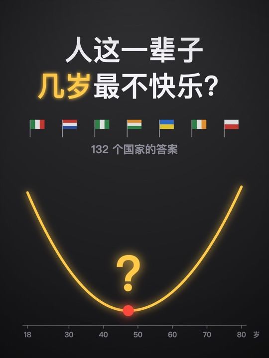
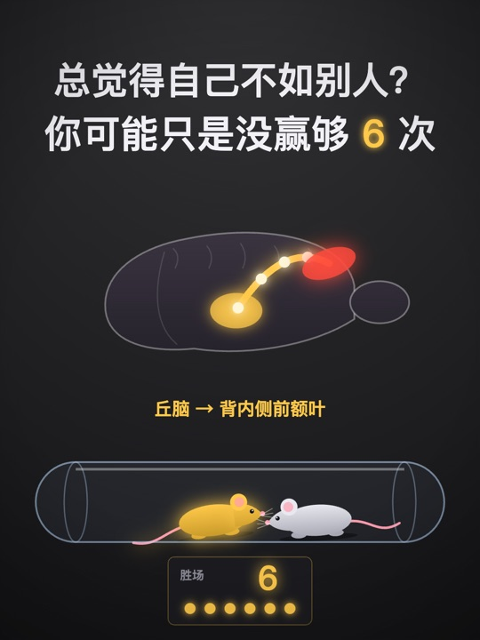
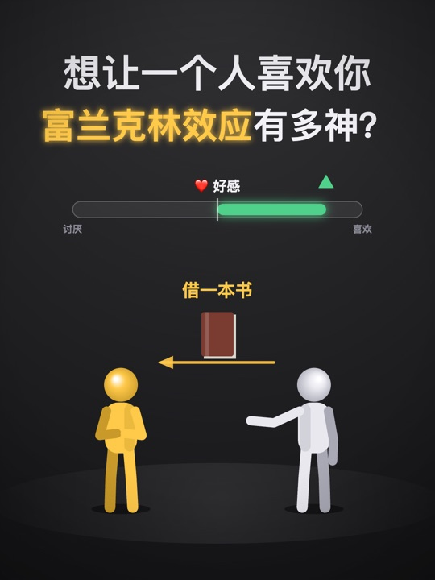
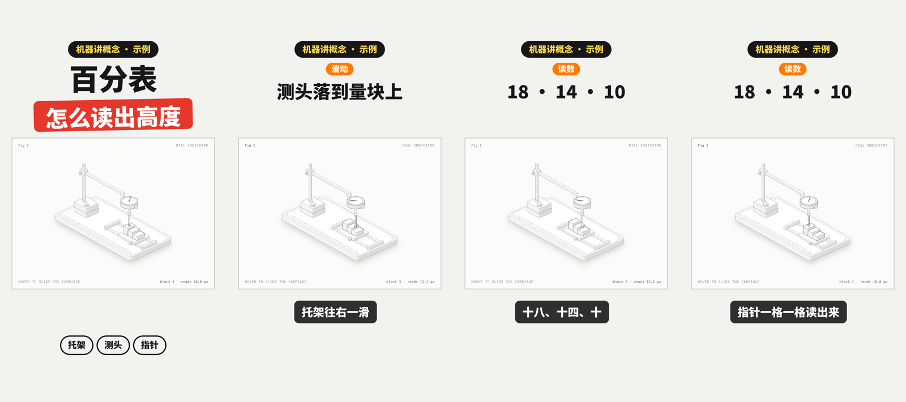
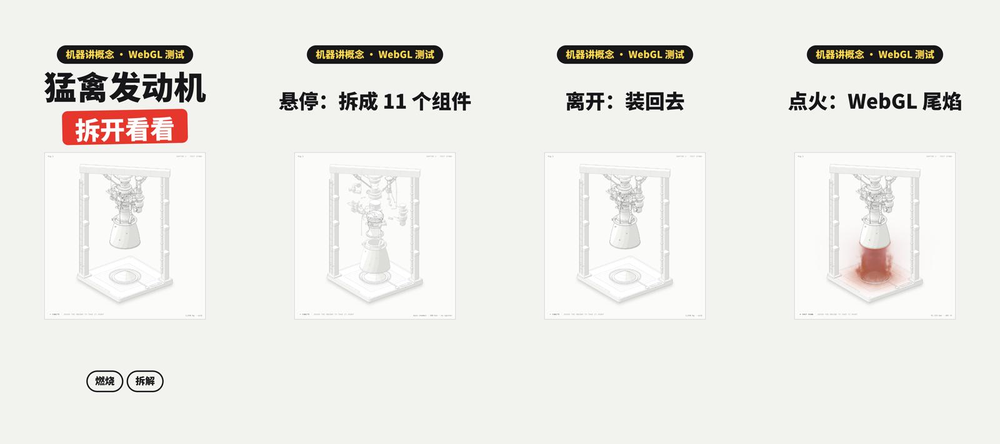

# charles-video-maker

[English](README_EN.md) | 中文

[](LICENSE)
[](https://www.python.org/)
[](https://nodejs.org/)
[](skills/charles-video-maker/bridge)
[](https://ffmpeg.org/)
[](skills/charles-video-maker/SKILL.md)

> 文字稿进去，带配音、字幕、封面和发布文案的竖版视频出来；画面可以是代码动画，也可以是真实素材打底。

一个 agent skill。模型写一个按时间 t 画画面的网页，逐帧截图合成视频；配音、对齐、字幕、配乐、事实核查、渲染、封面、发布文案整条流水线都在里面。在这个基础上还有三样东西：

- **素材层**：产品或游戏的实录、原视频里的原话、免版税空镜、生成补位，统一调色、按旁白卡点切换，代码画面退成透明的信息层叠在上面。
- **机器讲概念**：把技术概念造成一台会动的等距机器（[Anatomy](https://github.com/wheresryan22/anatomy)），旁白念到哪一步，机器就做哪一步。
- **风格库（可选）**：接入 [Lemo-Opuscar](https://github.com/lemomo-ai/lemo-opuscar) 的 53 种画风，外加真乐器配乐、离线配音和阅读时长检查。
- **抖音知识号模式**：从一条正在爆的原片出发，选题、蒸馏风格、写文案、配乐、渲染、封面、发布、拉数据一路做完，中途不停下来问。

## 代表作

下面三条都用本 skill 的抖音模式做成：画面是代码逐帧渲染出来的动画，配音、字幕、配乐、封面和发布文案也都由流水线产出，人只负责挑选题和最后过审。账号 2026-10-20 发出第一条，零粉丝起步，没有投抖加。数据截至 2026-11-02。

| [](examples/douyin-happiness-u.jpg) | [](examples/douyin-winner-effect.jpg) | [](examples/douyin-franklin-effect.jpg) |
|:---:|:---:|:---:|
| **你人生中幸福感最低的一年，会是几岁？** | **总觉得自己不如别人？你可能只是没赢够 6 次** | **想让一个人喜欢你，富兰克林效应有多神？** |
| 78 秒 · 23.1 万播放 | 66 秒 · 9.9 万播放 | 71 秒 · 1.3 万播放 |
| 7,053 次分享 · 2,537 条评论 | 1,441 次收藏 · 带来 102 个关注 | 373 赞 · 178 次收藏 |

同一套流水线也做出过几千播放和几十播放的片子。决定流量的主要是选题和开头 3 秒，工具只负责把成品质量稳定在一个水平上。

## 开工四选

开始做视频时，skill 一次问你四件事，每项都有默认值：

| 选项 | 默认 | 可选 |
|---|---|---|
| 画面 | 代码画面 | 素材打底（实录、原片、空镜、生成），或者 Lemo 风格库里的一种画风 |
| 规格 | 竖版短视频：1080×1920，30fps，第一帧就是封面，前 5 秒一句暴论 | 横版短片：1920×1080，24fps，电影节奏 |
| 配音 | Gemini TTS，1.25 倍速 | edge-tts，Kokoro（离线），不配音 |
| 流程 | 三个方案加预览，确认后再做 | 只问一次就开拍：写一份 TREATMENT.md 直接做 |

## 一条视频怎么做出来

```
文字稿 ──► 事实核查表 ──► 配音（整段合成、加速）──► 逐字时间戳 ──► 场景切点、动作点、字幕
                                                                        │
          ┌─────────────────────────────────────────────────────────────┘
          ▼
   代码画面 render(t) ──► 逐帧截图（并行）──┐
   素材层 footage.json ──► 剪切、调色、淡化 ─┼──► 合成 ──► out/<主题名>.mp4 + 封面图 + publish.txt
   配乐 + 音效 + 旁白 ──► -14 LUFS ────────┘
```

- **配音流水线**：旁白整段合成，用 Whisper 逐字时间戳把稿子原文对回去，场景切换、画面动作、音效、字幕都按念到的词定位，错别字不会进字幕。
- **素材层**：`record.py` 用 Chrome screencast 录网页，按实际时间重采样，清晰、时长准；`source.py` 下载、转写原视频，按一句话找到它在原片里的起止秒数；`stock.py` 搜 Pexels / Pixabay 并生成编号拼图供挑选；`compose.py` 把素材、透明代码层、配音合成，插入原片段落并保留原声，最后报告素材比例和来源缺失。
- **质量闸门**：事实核查闸门（稿子和画面上的数字都要在核对表里）、每个场景最满状态的拼图、阅读时长检查、帧数核对、响度和真峰值检查。
- **交付**：成片和封面按标题命名，`publish.txt` 只有标题、简介、5 个 tag 三段，直接复制到发布页。

## 抖音知识号模式

说做抖音视频、复刻这条抖音，或者用某种风格做一期，就走这条路。它不从想法出发，从一条正在爆的原片出发：风格一比一，内容不搬，在画面冲击力、质感和卡点上做得比原片更好。授权一次就做到交付，只有查不到一手资料或同一个工具连续失败两次时才停下来问。

```
D-1 题材雷达 ──► D1 蒸馏风格 ──► D2 资料与文案 ──► D3 先测配乐再排画面 ──► D4 制作与自查 ──► D5 交付
 douyin_radar     风格库          gemini_copy        voiceover-pipeline       still_check          封面、publish.txt
                                                                                                     │
                     数据结论写回运营手册 ◄── douyin_stats / douyin_comments ◄── douyin_publish ◄───┘
```

- **题材雷达**：`douyin_radar.py` 抓话题下的视频数据并排名，按需下载原片，产出选题表。
- **开头 3 秒**：`references/douyin-opening.md` 拆了一批头部爆款的开头，画面质感、第一句和声音各有检查表。
- **文案**：`gemini_copy.py` 交给本地 Gemini（Antigravity CLI `agy`）写旁白、标题和简介，skill 只负责校验事实和结构。
- **静止检查**：`still_check.py` 找出画面停住超过 2 秒的段落，以及字幕换了画面却没跟上的地方。
- **发布与数据**：`douyin_publish.py` 上传成片并定时发布；`douyin_stats.py` 拉每条作品的 2 秒跳出、5 秒完播、点赞、收藏、分享；`douyin_comments.py` 存评论。三个脚本都用一个已登录的专用浏览器配置。
- **系列化**：`references/douyin-series.md` 讲怎么把单条做成同一个世界、同一个主角的系列。

这个模式默认有两样东西要你自己准备：一个工作目录（默认 `~/Desktop/video/vibe-video/`，放原片库、风格库和工程），一份你自己维护的运营手册，用来记选题规律和数据结论。手册不存在时，开工读手册和数据写回这两步直接跳过，不影响出片。

## 效果

**百分表（Anatomy 最小的例子）配上旁白**：念到「往右一滑」托架滑过去，念到每个量块，测头就落到那一块上，读数跟着变。



**猛禽发动机（带 WebGL 尾焰）**：悬停拆成 11 个组件，离开装回去，点火时 WebGL 尾焰在同一个等距视角里喷出来。



## 安装

```bash
npx skills add anneheartrecord/charles-video-maker
```

或者手动复制：

```bash
git clone https://github.com/anneheartrecord/charles-video-maker.git
cp -r charles-video-maker/skills/charles-video-maker ~/.claude/skills/
```

### 需要的环境

- Python 3.9+，以及 `numpy`、`scipy`、`playwright`（`python3 -m pip install numpy scipy playwright`），再 `python3 -m playwright install chromium`
- FFmpeg
- Node.js 20.10+（Anatomy 的构建和检查只用 Node 内置模块）
- 配音：环境变量 `GEMINI_API_KEY`（Gemini TTS），或者 `edge-tts`（免费，`uv tool install edge-tts`）
- 对齐用的 Whisper：Apple Silicon 用 `mlx-whisper`，其他机器用 `faster-whisper`；不想全局安装可以 `uv run --with mlx-whisper ...`
- 素材层可选：`yt-dlp`（下载原片），环境变量 `PEXELS_API_KEY` 或 `PIXABAY_API_KEY`（空镜，免费申请），`GEMINI_API_KEY`（生成补位，需要开通生图额度）
- 抖音模式可选：Playwright 登录抖音创作者中心的专用浏览器配置（`~/.config/douyin/douyin-pw-profile`，脚本第一次运行时弹窗扫码），文案用的 Antigravity CLI `agy`
- 风格库可选：`sh skills/charles-video-maker/scripts/lemo/setup.sh deps` 会把 Lemo-Opuscar 下载到 `~/lemo-opuscar` 并装好依赖（约 350MB，需要 Node 20+、Python 3.11+ 或 uv）；真乐器采样库另外下载，全部约 1.3GB

所有 key 只从环境变量读取，不写进任何文件。

## 怎么用

直接说你想做什么：

```text
把这篇文章做成一条 60 秒的竖版视频，要配音和字幕（附上文字）
```

```text
给这个网页游戏做一条介绍视频，用实机画面，链接是 https://...
```

```text
这是原视频链接和我的文字稿，画面多用原片和空镜，别全是插图
```

```text
做一条讲 CDN 缓存命中和未命中的竖版视频，用一台会动的机器讲清楚
```

```text
用水彩风格做一条 45 秒的短片，讲茶叶从采摘到冲泡
```

```text
找 10 个 Vibe 知识大赏下正在涨的抖音选题，挑最好的一条做一期
```

## 目录

```
skills/charles-video-maker/
  SKILL.md                 分流（视频 / 插图 / 机器讲概念）+ 开工四选 + 视频流程
  references/              方案、brief、制作规则、封面与开头、配音流水线、事实核查、
                           机器讲概念、素材层、风格库接入、抖音模式（复刻、开头、系列、文案）
  scripts/                 渲染（含并行、透明输出）、事实核查、自检拼图、文件命名、音频工具、
                           抖音雷达 / 发布 / 数据 / 评论、Gemini 文案、静止检查
  scripts/voice/           配音、对齐、时间轴与字幕、混音、真乐器配乐
  scripts/footage/         实录、原片、空镜、生成补位、合成
  scripts/lemo/            风格库下载
  templates/               竖版讲解模板
  bridge/                  虚拟时钟、视频叠加层、页面包装脚本、示例
  anatomy/                 Anatomy 原样收录
examples/                  README 用的效果图
```

## 致谢与协议

- 视频流程、参考文档和渲染脚本起步于 [周行（Kianzzz）](https://github.com/Kianzzz) 的 [xilo-opus-video](https://github.com/Kianzzz/xilo-opus-video)。
- `anatomy/` 原样收录自 [Ryan（@wheresryan22）](https://github.com/wheresryan22) 的 [Anatomy](https://github.com/wheresryan22/anatomy)，未做修改。
- 抖音模式的起号与复刻打法改写自蔚蓝 WEILANX 的《Opus 5.5 抖音起号超级保姆级万字教程》第五、六章。
- 风格库、真乐器采样器、Kokoro 配音和阅读时长检查来自 LemoLab 的 [Lemo-Opuscar](https://github.com/lemomo-ai/lemo-opuscar)，按需下载使用，不收进本仓库。
- 各部分的来源、版本和改动见 [NOTICE.md](NOTICE.md)，后续计划见 [ROADMAP.md](ROADMAP.md)。

MIT，保留所有原作者的版权声明，见 [LICENSE](LICENSE)。
