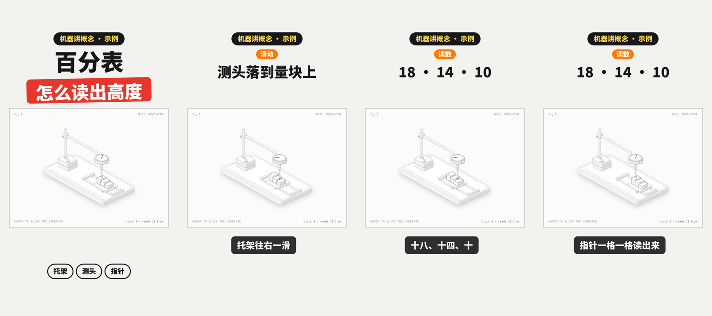

# charles-video-maker

English | [中文](README.md)

[](LICENSE)
[](https://www.python.org/)
[](https://nodejs.org/)
[](skills/charles-video-maker/bridge)
[](https://ffmpeg.org/)
[](skills/charles-video-maker/SKILL.md)

> A written script goes in; a narrated vertical video with subtitles, a cover and publish copy comes out. The picture can be code animation or real footage underneath.

An agent skill. The model writes a page that draws frame t, captured frame by frame into a video; voice, alignment, subtitles, score, fact-checking, rendering, cover and publish copy are one pipeline. On top of that:

- **Footage layer**: screen recordings of a product or game, quotes from a source video, royalty-free b-roll and generated stills, graded and cut on narration cues, with the code picture reduced to a transparent information layer on top.
- **Machines that explain ideas**: a technical idea built as a working isometric machine ([Anatomy](https://github.com/wheresryan22/anatomy)) that does each step as the narration reaches it.
- **Style library (optional)**: the 53 styles of [Lemo-Opuscar](https://github.com/lemomo-ai/lemo-opuscar), plus sampled-instrument scores, an offline voice and a reading-time check.
- **Douyin knowledge-video mode**: start from a video that is taking off right now, then topic, style, script, score, render, cover, publishing and stats run end to end without stopping to ask.

## Showcase

These three were made with the skill's Douyin mode. The picture is animation rendered frame by frame from code; voice, subtitles, score, cover and publish copy come out of the pipeline. A person only picks the topic and does the final review. The account posted its first video on 2026-10-20 with zero followers and no paid promotion. Numbers as of 2026-11-02.

| [](examples/douyin-happiness-u.jpg) | [](examples/douyin-winner-effect.jpg) | [](examples/douyin-franklin-effect.jpg) |
|:---:|:---:|:---:|
| **At what age is your life least happy?** | **Feel you're worse than everyone? Maybe you just haven't won 6 times** | **Want someone to like you? How the Franklin effect works** |
| 78 s · 231K views | 66 s · 99K views | 71 s · 13K views |
| 7,053 shares · 2,537 comments | 1,441 saves · 102 new followers | 373 likes · 178 saves |

The same pipeline has also produced videos with a few thousand views and a few dozen. Topic and the first 3 seconds decide the reach; the tool keeps the finished quality at a steady level.

## Four choices at the start

When a video starts, the skill asks four things at once; each has a default:

| Choice | Default | Alternatives |
|---|---|---|
| Picture | code picture | footage underneath (recordings, source quotes, b-roll, generated), or one Lemo-Opuscar style |
| Format | vertical short: 1080×1920, 30 fps, cover as frame 0, a bold claim in the first 5 s | horizontal film: 1920×1080, 24 fps, cinematic pacing |
| Voice | Gemini TTS at 1.25x | edge-tts, Kokoro (offline), none |
| Workflow | three plans with previews, build after approval | ask once and go: write a TREATMENT.md and build |

## How a video is made

```
script ──► fact-check table ──► voice (one take, sped up) ──► word timestamps ──► scene cuts, cues, subtitles
                                                                                     │
          ┌──────────────────────────────────────────────────────────────────────────┘
          ▼
   code picture render(t) ──► frame capture (parallel) ──┐
   footage layer footage.json ──► cut, grade, fade ──────┼──► composite ──► out/<topic>.mp4 + cover + publish.txt
   score + effects + voice ──► -14 LUFS ─────────────────┘
```

- **Voiceover pipeline**: the narration is synthesized in one take and Whisper word timestamps are aligned back to the script text, so scene changes, on-screen actions, sound effects and subtitles land on the spoken words, and recognition mistakes never reach the subtitles.
- **Footage layer**: `record.py` records a web page through Chrome's screencast, re-timed to a constant frame rate; `source.py` downloads and transcribes a source video and finds where a sentence is said; `stock.py` searches Pexels / Pixabay and builds a numbered contact sheet; `compose.py` composites footage, the transparent code layer and the voice, splices in quotes with their own sound, and reports the material mix and missing credits.
- **Quality gates**: a fact-check gate (numbers in the script and on screen must be in the table), a sheet of every scene at its fullest, a reading-time check, frame-count checks, loudness and true-peak checks.
- **Delivery**: the video and cover are named after the title; `publish.txt` holds only the title, the description and 5 tags.

## Douyin knowledge-video mode

Say "make a Douyin video", "remake this Douyin video" or "do one in style X", and the skill takes this route. It does not start from an idea. It starts from a video that is taking off: the style is matched one to one, the content is never copied, and the picture, texture and timing are pushed past the original. One request authorizes the whole run; it stops to ask only when no primary source can be found or the same tool fails twice in a row.

```
D-1 topic radar ──► D1 distill style ──► D2 sources & script ──► D3 score first, then picture ──► D4 build & self-check ──► D5 deliver
 douyin_radar        style library        gemini_copy             voiceover-pipeline                still_check               cover, publish.txt
                                                                                                                                │
                          findings written back to the ops handbook ◄── douyin_stats / douyin_comments ◄── douyin_publish ◄───┘
```

- **Topic radar**: `douyin_radar.py` pulls and ranks the videos under a hashtag, downloads source videos on demand, and produces a topic table.
- **The first 3 seconds**: `references/douyin-opening.md` takes apart the openings of a batch of top videos, with checklists for texture, the first line and sound.
- **Script**: `gemini_copy.py` hands narration, title and description to a local Gemini (Antigravity CLI `agy`); the skill checks facts and structure.
- **Still check**: `still_check.py` finds stretches where the picture stops for more than 2 seconds, and subtitle changes the picture doesn't follow.
- **Publishing and stats**: `douyin_publish.py` uploads and schedules a video; `douyin_stats.py` pulls 2-second bounce, 5-second completion, likes, saves and shares per video; `douyin_comments.py` saves comments. All three use a dedicated, logged-in browser profile.
- **Series**: `references/douyin-series.md` covers turning one-offs into a series with one world and one recurring character.

This mode expects two things you set up yourself: a working directory (default `~/Desktop/video/vibe-video/`, holding source videos, the style library and projects), and an ops handbook you maintain for topic rules and findings. Without the handbook, the read-the-handbook and write-back steps are skipped; videos still come out.

## Results

**The dial indicator (Anatomy's smallest example), narrated**: the carriage slides when the narration says so, and the probe drops onto each gauge block as it is named.



**The Raptor engine (with a WebGL plume)**: hover takes it apart into 11 assemblies, leaving puts it back, and on ignition the WebGL plume fires in the same isometric camera.


## Install

```bash
npx skills add anneheartrecord/charles-video-maker
```

Or copy it manually:

```bash
git clone https://github.com/anneheartrecord/charles-video-maker.git
cp -r charles-video-maker/skills/charles-video-maker ~/.claude/skills/
```

### Requirements

- Python 3.9+ with `numpy`, `scipy` and `playwright` (`python3 -m pip install numpy scipy playwright`), then `python3 -m playwright install chromium`
- FFmpeg
- Node.js 20.10+ (Anatomy's builds and checks use only built-in modules)
- Voice: the `GEMINI_API_KEY` environment variable (Gemini TTS), or `edge-tts` (free, `uv tool install edge-tts`)
- Whisper for alignment: `mlx-whisper` on Apple Silicon, `faster-whisper` elsewhere; or run `uv run --with mlx-whisper ...`
- Footage layer, optional: `yt-dlp` (source videos), `PEXELS_API_KEY` or `PIXABAY_API_KEY` (b-roll, free), `GEMINI_API_KEY` with image quota (generated stills)
- Douyin mode, optional: a dedicated Playwright browser profile logged in to the Douyin creator center (`~/.config/douyin/douyin-pw-profile`; the first run opens a QR login), and the Antigravity CLI `agy` for scripts
- Style library, optional: `sh skills/charles-video-maker/scripts/lemo/setup.sh deps` downloads Lemo-Opuscar to `~/lemo-opuscar` and installs its packages (about 350 MB; needs Node 20+ and Python 3.11+ or uv); the sample libraries are about 1.3 GB more

Keys are read from environment variables only and never written to any file.

## Usage

Just say what you want:

```text
Turn this article into a 60-second vertical video with voiceover and subtitles (text attached)
```

```text
Make an intro video for this web game from real gameplay: https://...
```

```text
Here is the source video and my script; use clips from it and b-roll, not just illustrations
```

```text
Make a vertical video about CDN cache hits and misses, explained by a working machine
```

```text
A 45-second watercolor film about tea, from picking to brewing
```

```text
Find 10 Douyin topics rising under #Vibe知识大赏 and make one from the best
```

## Layout

```
skills/charles-video-maker/
  SKILL.md                 routing (video / figure / machine explainer) + four choices + the video workflow
  references/              plans, brief, craft rules, cover and opening, voiceover, fact-check,
                           machine explainer, footage layer, style library, Douyin mode (remake, opening, series, script)
  scripts/                 rendering (parallel, transparent output), fact-check, QA sheet, naming, audio tools,
                           Douyin radar / publish / stats / comments, Gemini script, still check
  scripts/voice/           voice, alignment, timeline and subtitles, mix, sampled scores
  scripts/footage/         recording, source quotes, b-roll, generated stills, compositing
  scripts/lemo/            style library setup
  templates/               vertical explainer template
  bridge/                  virtual clock, video overlay, page wrapper, example
  anatomy/                 Anatomy vendored as-is
examples/                  images for this README
```

## Credits and license

- The video workflow, references and rendering scripts started from [xilo-opus-video](https://github.com/Kianzzz/xilo-opus-video) by [周行 (Kianzzz)](https://github.com/Kianzzz).
- `anatomy/` is [Anatomy](https://github.com/wheresryan22/anatomy) by [Ryan (@wheresryan22)](https://github.com/wheresryan22), vendored unmodified.
- The Douyin mode's account-building and remake playbook is adapted from chapters 5 and 6 of WEILANX's Opus 5.5 Douyin account-building tutorial.
- The style library, sampled-instrument scoring, Kokoro voice and reading-time check come from [Lemo-Opuscar](https://github.com/lemomo-ai/lemo-opuscar) by LemoLab, downloaded on demand and not copied into this repository.
- Sources, versions and changes are in [NOTICE.md](NOTICE.md); plans in [ROADMAP.md](ROADMAP.md).

MIT, keeping every original copyright notice. See [LICENSE](LICENSE).
